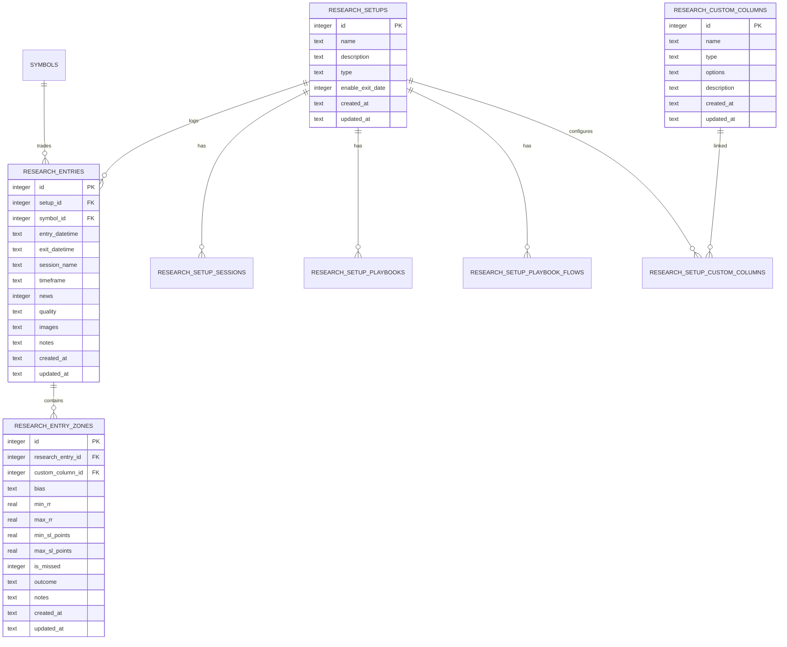

# ข้อกำหนดระบบ "จดสถิติ" (Trade & Zone Research Requirements)

> **เอกสารข้อกำหนดทางเทคนิคและฟังก์ชันการทำงาน (Requirement Specification)**  
> โมดูล: **จดสถิติ (Trade & Zone Research / Hypothesis Testing)**  
> สำหรับโปรเจกต์: **Trading Journal v2**  
> สถานะ: **Approved / Ready for Implementation**

---

## 1. ภาพรวมและวัตถุประสงค์ (Overview & Objectives)

### 1.1 ที่มาและปัญหา
ในการเทรดทางเทคนิค แม้จะเป็น Setup หรือกลยุทธ์เดียวกัน แต่นักเทรดมักมีจุดเข้าออเดอร์ (Entry Zones) หลากหลายทางเลือก เช่น *เข้าทันทีที่แตะ Zone, รอ Retest, เข้าที่ FVG, เข้าที่ Order Block (OB), หรือรอ Liquidity Sweep* 

การบันทึกใน Journal ปกติมักบันทึกเฉพาะไม้ที่ได้เข้าจริง (Execution) ทำให้ขาดข้อมูลสำคัญในเชิงวิจัย ได้แก่:
- โซนไหนให้อัตราการได้ของ (Fill Rate) สูงสุด หรือโซนไหนตกรถ (Miss Rate) บ่อยที่สุด
- โซนไหนให้ความแม่นยำ (Win Rate) และผลตอบแทนต่อความเสี่ยง (Risk:Reward - RR) คุ้มค่าที่สุด
- โซนไหนเกิด Drawdown หรือจุด Stop Loss (SL Points) สั้นที่สุด

### 1.2 วัตถุประสงค์ของโมดูล "จดสถิติ"
1. **แยกอิสระจาก Journal เดิมโดยสิ้นเชิง:** ไม่ปะปนกับบันทึกการเทรดปกติ ข้อมูล สถิติ และการตั้งค่าแยกตารางกันชัดเจน (ยกเว้น Symbols ที่ใช้ร่วมกันได้)
2. **เน้นความรวดเร็วในการบันทึกข้อมูล (Speed-focused Data Entry):** ลดทอนฟิลด์ที่ไม่จำเป็นในเชิงวิจัยออก เช่น ไม่จำเป็นต้องกรอก Exit Date ทุกครั้ง (ซ่อนไว้เป็นค่าเริ่มต้น เว้นแต่เปิดใช้งานใน Setup) มีระบบคัดลอกค่าอัตโนมัติ (Auto-sync Bias, Auto-copy SL Points) และมีปุ่มลัด One-Click Actions
3. **วิจัยสมมติฐานเปรียบเทียบระหว่างโซน (Zone Comparison & Edge Analysis):** ใน 1 ไม้/เหตุการณ์ สามารถทดสอบและบันทึกผลลัพธ์ของแต่ละโซนคู่ขนานกันได้ผ่าน Custom Columns

---

## 2. โครงสร้างเมนูและการนำทาง (Menu & Navigation Structure)

เพิ่มหมวดหมู่ใหม่บน **AppSidebar** แยกเป็นสัดส่วนชัดเจน:

```text
├── ── JOURNAL (เดิม) ──
│   ├── Dashboard
│   ├── Win/Loss Report
│   ├── Monte Carlo
│   ├── Edge Analysis
│   ├── Calendar
│   ├── New Trade
│   ├── Data Management
│   └── Settings
│
└── ── TRADE RESEARCH (ใหม่) ──
    ├── 📝 จดสถิติ (New Entry)        --> /research/entry
    ├── 📊 สรุปผลวิจัย (Analytics)       --> /research/dashboard
    └── ⚙️ ตั้งค่าสถิติ (Settings)        --> /research/settings
```

### เมนูย่อยในหน้าตั้งค่าสถิติ (`/research/settings`)
ประกอบด้วย 5 แท็บการตั้งค่า (เลียนแบบ Journal เดิม แต่สร้างเป็นตารางใหม่ทั้งหมด ยกเว้น Symbols):
1. **Setups วิจัย (`Trading Setups`)**: จัดการ Setup สำหรับวิจัย พร้อมสวิตช์เปิด/ปิด `Enable Exit Date`
2. **Symbols (`Symbols`)**: ใช้ตารางร่วมกับ Journal เดิม (แชร์รายการคู่เงิน/สินทรัพย์ร่วมกัน ไม่ต้องสร้างใหม่)
3. **Setup Sessions (`Setup Sessions`)**: กำหนดช่วงเวลาเซสชัน (Asia, Tokyo, London, London Close, New York) ผูกกับแต่ละ Setup วิจัย เพื่อใช้ Auto-detect Session
4. **Setup Playbooks & Flow (`Playbooks`)**: จดบันทึกกฎเกณฑ์ ทฤษฎี และสร้าง Diagram ด้วย **Vue Flow** ผูกกับแต่ละ Setup วิจัย
5. **Custom Columns (`Zone Library`)**: สร้างและกำหนดชุด Custom Columns / Zones ที่ต้องการนำมาทดสอบ

---

## 3. โครงสร้างฐานข้อมูล (Database Schema & Data Model)

ตารางทั้งหมดถูกสร้างขึ้นใหม่ใน SQLite ผ่าน **Drizzle ORM** ในไฟล์ `src/main/db/schema.ts` (ยกเว้น `symbols`):



### 3.1 รายละเอียดแต่ละตาราง

#### 1) `research_setups` (ตาราง Setup สำหรับวิจัย)
- `id` (Integer, PK, Auto Increment)
- `name` (Text, Not Null): ชื่อ Setup เช่น *"OB + FVG Reversal"*, *"Asian Sweep M5"*
- `description` (Text): คำอธิบายกลยุทธ์
- `type` (Text, Not Null): ประเภท เช่น `backtest`, `forward_test`, `demo`, `real`
- `enable_exit_date` (Integer as Boolean, Default: `false`): **หากเป็น `true` หน้าจดสถิติจะแสดงช่อง Exit Datetime ให้กรอก หากเป็น `false` จะซ่อนไว้เพื่อความรวดเร็วในการบันทึก**
- `created_at`, `updated_at` (Text ISO Timestamp)

#### 2) `symbols` (ตารางเดิม ใช้ร่วมกัน)
- ใช้ตาราง `symbols` ที่มีอยู่เดิมในระบบ ไม่สร้างตารางใหม่

#### 3) `research_setup_sessions` (เซสชันเวลา ผูกกับ Setup วิจัย)
- `id` (Integer, PK, Auto Increment)
- `setup_id` (Integer, FK -> `research_setups.id`, Cascade Delete)
- `start_time` (Text, Not Null): เวลาเริ่ม เช่น `"14:00"`
- `end_time` (Text, Not Null): เวลาสิ้นสุด เช่น `"17:00"`
- `session_name` (Text, Not Null): `Asia`, `Tokyo`, `London`, `London Close`, `New York`
- `created_at`, `updated_at` (Text ISO Timestamp)

#### 4) `research_setup_playbooks` (คู่มือกลยุทธ์แบบข้อความ)
- `id` (Integer, PK, Auto Increment)
- `setup_id` (Integer, FK -> `research_setups.id`, Cascade Delete)
- `content` (Text, Not Null): รายละเอียดเงื่อนไขและกฎเกณฑ์
- `created_at`, `updated_at` (Text ISO Timestamp)

#### 5) `research_setup_playbook_flows` (คู่มือกลยุทธ์แบบ Visual Flowchart)
- `id` (Integer, PK, Auto Increment)
- `setup_id` (Integer, FK -> `research_setups.id`, Unique, Cascade Delete)
- `flow_data` (Text as JSON, Not Null): Node และ Edge สำหรับแสดงผลใน **Vue Flow**
- `created_at`, `updated_at` (Text ISO Timestamp)

#### 6) `research_custom_columns` (Library รายการโซน / ตัวแปรที่วิจัย)
- `id` (Integer, PK, Auto Increment)
- `name` (Text, Not Null): ชื่อโซนหรือพารามิเตอร์ เช่น `"Zone FVG M15"`, `"Zone Extreme OB"`, `"Zone Breaker"`
- `type` (Text, Not Null): `zone_group`, `checkbox`, `single_selector`, `string`, `number`
- `options` (Text as JSON): ตัวเลือกเพิ่มเติม (ถ้ามี)
- `description` (Text): คำอธิบายลักษณะของโซน
- `created_at`, `updated_at` (Text ISO Timestamp)

#### 7) `research_setup_custom_columns` (Junction Table เชื่อม Setup กับ Custom Columns)
- `id` (Integer, PK, Auto Increment)
- `setup_id` (Integer, FK -> `research_setups.id`, Cascade Delete)
- `custom_column_id` (Integer, FK -> `research_custom_columns.id`, Cascade Delete)
- `order_index` (Integer, Default: 0): ลำดับการแสดงผลในหน้าจดสถิติ
- `created_at`, `updated_at` (Text ISO Timestamp)

#### 8) `research_entries` (บันทึกหลักของการวิจัย)
- `id` (Integer, PK, Auto Increment)
- `setup_id` (Integer, FK -> `research_setups.id`, Cascade Delete)
- `symbol_id` (Integer, FK -> `symbols.id`)
- `entry_datetime` (Text, Not Null): วันเวลาที่เกิดสัญญาณเข้า
- `exit_datetime` (Text, Nullable): วันเวลาที่ออก (บันทึกเฉพาะกรณีที่ Setup เปิด `enable_exit_date = true`)
- `session_name` (Text): ตรวจจับอัตโนมัติจาก `entry_datetime` เปรียบเทียบกับ `research_setup_sessions`
- `timeframe` (Text): กรอบเวลาที่เข้า เช่น M1, M5, M15, H1
- `news` (Integer as Boolean, Default: `false`): มีข่าวเศรษฐกิจสำคัญหรือไม่
- `quality` (Text): เกรดคุณภาพ เช่น `A+`, `A`, `B`, `C` หรือรหัสสี
- `images` (Text as JSON Array): รายการ relative path ของรูปภาพประกอบ
- `notes` (Text): บันทึกข้อสังเกตทั่วไป
- `created_at`, `updated_at` (Text ISO Timestamp)

#### 9) `research_entry_zones` (ข้อมูลผลลัพธ์ประจำแต่ละ Custom Column / โซนในไม้นั้น)
- `id` (Integer, PK, Auto Increment)
- `research_entry_id` (Integer, FK -> `research_entries.id`, Cascade Delete)
- `custom_column_id` (Integer, FK -> `research_custom_columns.id`, Cascade Delete)
- `bias` (Text): `Bullish` หรือ `Bearish`
- `min_rr` (Real): ผลลัพธ์ Risk:Reward ขั้นต่ำ (หากแพ้ให้ใส่ `-1`)
- `max_rr` (Real): ผลลัพธ์ Risk:Reward สูงสุดที่ราคาวิ่งไปถึง (หากแพ้ให้ใส่ `-1`)
- `min_sl_points` (Real): ระยะ Stop Loss (Points/Pips) ของจุดเข้า Min
- `max_sl_points` (Real): ระยะ Stop Loss (Points/Pips) ของจุดเข้า Max
- `is_missed` (Integer as Boolean, Default: `false`): เช็คบ็อกซ์ "ตกรถ" (ราคามาไม่ถึงโซน)
- `outcome` (Text): สถานะสรุปผลลัพธ์ (`win`, `loss`, `be`, `missed`)
- `notes` (Text): บันทึกหมายเหตุเฉพาะโซนนั้น (Optional)
- `created_at`, `updated_at` (Text ISO Timestamp)

---

## 4. ข้อกำหนดฟอร์มจดสถิติ (Data Entry Form & UX Rules)

### 4.1 ฟิลด์ข้อมูลหลัก (Main Header Fields)
1. **เลือก Setup วิจัย (`setup_id`)**: โหลดเฉพาะ Setup จาก `research_setups`
2. **เลือก Symbol (`symbol_id`)**: โหลดจาก `symbols`
3. **เวลาเข้า (`entry_datetime`)**:
   - ผู้ใช้กรอกแค่วันที่และเวลาเข้า
   - ระบบทำการคำนวณและ Auto-detect **Session** ให้อัตโนมัติทันที
4. **เวลาออก (`exit_datetime`)**:
   - หาก Setup ที่เลือกถูกตั้งค่า `enable_exit_date = false` -> **ซ่อนช่องนี้ทันที** เพื่อความรวดเร็วในการจด
   - หาก `enable_exit_date = true` -> แสดงฟิลด์ Date/Time Picker ให้กรอกได้
5. **Timeframe**: เมนูดรอปดาวน์เลือกกรอบเวลา (เช่น M1, M3, M5, M15, M30, H1, H4, D1)
6. **Screenshots (ภาพถ่ายกราฟ)**:
   - เลียนแบบโค้ดและ UX เดิมของ Journal (รองรับอัปโหลดหลายรูป, ลากไฟล์มาวาง Drag & Drop, แปะจากคลิปบอร์ด `Ctrl + V`, ดูภาพขยาย Lightbox, และปุ่มลบรูป)
7. **มีข่าว (News Checkbox)**: สวิตช์ระบุว่ามีข่าว High Impact ช่วงเวลานั้นหรือไม่
8. **Trade Quality**: เกรดความมั่นใจ/คุณภาพการเข้าเทรด (`A+`, `A`, `B`, `C` หรือ 5 สี)
9. **หมายเหตุรวม (Notes)**: บันทึกข้อความอิสระ

---

### 4.2 การทำงานของ Custom Column แต่ละโซน (Zone Component Logic)

เมื่อผู้ใช้เลือก Setup ใด ระบบจะดึง Custom Columns (โซนเข้า) ทั้งหมดที่ผูกกับ Setup นั้นมาแสดงผลเป็น Card หรือ Table Block แต่ละคอลัมน์จะมีชุดข้อมูลให้กรอก ดังนี้:

#### กฎข้อที่ 1: การกรอก Bias (Bullish / Bearish) และ Auto-Sync
- **พฤติกรรมตัวแรกสุด (First Column Sync):** เมื่อผู้ใช้คลิกเลือก Bias (`Bullish` หรือ `Bearish`) ที่ **Custom Column ตัวแรก** -> ระบบจะคัดลอกค่า Bias เดียวกันนี้ไปใส่ให้กับ Custom Columns ทุกตัวที่เหลือโดยอัตโนมัติ เพื่อประหยัดเวลา
- **พฤติกรรมตัวถัดไป (Subsequent Columns Override):** หากผู้ใช้ไปคลิกเปลี่ยนค่า Bias ที่ Custom Column ลำดับที่ 2, 3, 4, ... -> **ระบบจะไม่ส่งผลต่อตัวอื่น** โดยถือว่าเป็นการ Override เฉพาะโซนนั้น

#### กฎข้อที่ 2: การกรอก Min RR และ Max RR
- **Min RR:** อัตราส่วนกำไรขั้นต่ำที่เก็บได้ (เช่น TP1 หรือเป้าหมายปลอดภัย)
- **Max RR:** อัตราส่วนกำไรสูงสุดที่ราคาวิ่งไปถึงก่อนกลับตัว
- **กรณีแพ้ (Loss):** ให้กรอกค่าเป็น `-1`

#### กฎข้อที่ 3: การกรอก SL Points และ Auto-Copy
- **เมื่อกรอกช่อง SL Points ของ Min RR:** ระบบจะคัดลอกค่านั้นไปวางในช่อง SL Points ของ Max RR ให้อัตโนมัติ
- **เมื่อแก้ไขช่อง SL Points ของ Max RR:** ระบบจะไม่ย้อนกลับไปแก้ไขค่าของ Min RR

#### กฎข้อที่ 4: เช็คบ็อกซ์ "ตกรถ" (Missed Entry)
- หากราคามาไม่ถึงโซน และไม่ได้ของ ให้ติ๊ก `[x] ตกรถ`
- เมื่อติ๊ก "ตกรถ" ระบบจะตั้งค่าสถานะเป็น `missed` อัตโนมัติ พร้อมทำการ Clear และ Disable ช่องกรอก RR ชั่วคราว เพื่อป้องกันการนำไปคำนวณปนกับผลแพ้ชนะ

#### กฎข้อที่ 5: ปุ่มลัด One-Click Result Actions (ประหยัดเวลา)
ในแต่ละ Custom Column จะมีปุ่ม Action ด่วนให้คลิกเดียวได้ผลทันที:
- ปุ่ม **`[SL (-1)]`**: กรอก Min RR = `-1` และ Max RR = `-1` ทันที
- ปุ่ม **`[BE (0)]`**: กรอก Min RR = `0` (Break Even)
- ปุ่ม **`[Missed (ตกรถ)]`**: ติ๊กตกรถทันที
- ปุ่ม Quick RR: เช่น `[+1R]`, `[+2R]`, `[+3R]`, `[+5R]` (สามารถกดเพื่อเติมค่า Min RR ได้ไวขึ้น)

#### กฎข้อที่ 6: การคำนวณสถานะผลลัพธ์ของโซน (Zone Outcome Classification)
ระบบจัดกลุ่มสถานะของแต่ละโซนให้อัตโนมัติ:
- `is_missed == true` -> **Missed** (ตกรถ)
- `min_rr == -1` หรือ `max_rr == -1` -> **Loss** (แพ้)
- `min_rr == 0` -> **Break Even** (เท่าทุน)
- `min_rr > 0` -> **Win** (ชนะ)

---

## 5. การวิเคราะห์และสรุปผลสถิติวิจัย (Research Analytics & Dashboard)

หน้า **สรุปผลวิจัย (`/research/dashboard`)** ถูกออกแบบมาเพื่อตอบคำถาม:  
> *"ใน Setup นี้... โซนไหนเวิร์คที่สุด? โซนไหนตกรถบ่อย? โซนไหน RR คุ้มค่าที่สุด?"*

### 5.1 ตัวชี้วัดสำคัญประจำแต่ละโซน (Per-Zone Performance Metrics)
ระบบจะทำการรวมรวมสถิติและเปรียบเทียบในรูปแบบ **Zone Comparison Table**:

| ตัวชี้วัด (Metric) | ความหมายและสูตรคำนวณ |
| :--- | :--- |
| **Total Samples** | จำนวนครั้งทั้งหมดที่มีสัญญาณของ Setup นี้ |
| **Fill Rate (%)** | อัตราที่ราคาลงมาเกี่ยวกับออเดอร์ในโซน = `(จำนวนครั้งที่ได้ของ / Total Samples) * 100` |
| **Miss Rate (%)** | อัตราการตกรถ = `(จำนวนครั้งที่ตกรถ / Total Samples) * 100` |
| **Win Rate (%)** | คำนวณจาก **เฉพาะไม้ที่ได้ของ (Filled Trades เท่านั้น)** = `(Wins / (Wins + Losses + BE)) * 100` |
| **Loss Rate (%)** | อัตราการแพ้เมื่อได้ของ = `(Losses / Filled Trades) * 100` |
| **Avg Min RR** | ค่าเฉลี่ย Risk:Reward ขั้นต่ำที่ทำได้ |
| **Avg Max RR** | ค่าเฉลี่ยจุดสูงสุดที่ราคาวิ่งไปถึง (Potential Peak RR) |
| **Avg SL Points** | ระยะ Stop Loss เฉลี่ยของโซนนี้ (บอกความคมในการวางจุดตัดขาดทุน) |
| **Expected Value (EV)** | ค่าความคุ้มค่าเฉลี่ยต่อการเทรด 1 ครั้ง = `(Win Rate * Avg Win RR) - (Loss Rate * 1)` |

### 5.2 ป้ายรางวัลแนะนำโซนที่ดีที่สุด (Best Zone Badges)
ระบบวิเคราะห์และแสดงป้ายกำกับอัตโนมัติบนหัวสรุป:
- 🏆 **Most Profitable Zone (Best EV):** โซนที่มีค่า Expected Value สูงสุดในระยะยาว
- 🎯 **Highest Win Rate:** โซนที่ชน SL น้อยที่สุด (แม่นยำที่สุด)
- 🚊 **Lowest Miss Rate (Most Reliable Entry):** โซนที่ราคาลงมาเกี่ยวบ่อยที่สุด ตกรถน้อยที่สุด
- 🚀 **Highest RR Potential:** โซนที่ให้ค่า Max RR เฉลี่ยสูงที่สุด

### 5.3 ตัวกรองข้อมูลวิจัย (Research Filter Bar)
ผู้ใช้วิจัยสามารถกรองดู Insight ลึกข้ามเงื่อนไขได้:
- กรองตาม **Setup**
- กรองตาม **Symbol**
- กรองตาม **Session** (เช่น โซนนี้ใน London กับ New York ผลต่างกันหรือไม่)
- กรองตาม **Timeframe**
- กรองตาม **ช่วงที่มีข่าว vs ไม่มีข่าว**
- กรองตาม **Trade Quality**

---

## 6. มาตรฐานทางเทคนิคและสถาปัตยกรรม (Technical Architecture)

1. **Stack & Platform:**
   - Electron + electron-vite
   - Frontend: Vue 3 (Composition API, `<script setup>`, TypeScript Strict)
   - State Management: Pinia Store (`useResearchStore`, `useResearchSettingsStore`)
   - Styling & UI: Tailwind CSS + shadcn-vue
   - Database: better-sqlite3 + Drizzle ORM (รัน migration อัตโนมัติ)
2. **Local & Offline 100%:**
   - ไม่มี Cloud, ไม่มีการส่งข้อมูลออกนอกเครื่อง
   - รูปภาพถูกบันทึกลงในเครื่อง และเรียกผ่าน Custom Protocol `app-img://`
3. **Component & Testing Standards (ตาม AGENTS.md):**
   - ทุกหน้าและ Component สำคัญต้องมีไฟล์ **Storybook** (`.stories.ts`) ควบคู่กัน
   - หน้ารายละเอียด Setup Playbooks รองรับการแสดงผลไดอะแกรมด้วย **Vue Flow**
   - รองรับ E2E Testing ด้วย Playwright
4. **IPC Channel Conventions:**
   - `research-setups:*` (list, create, update, delete)
   - `research-sessions:*` (list, create, update, delete)
   - `research-playbooks:*` (get, save, saveFlow)
   - `research-custom-columns:*` (list, create, update, delete, linkToSetup)
   - `research-entries:*` (list, getById, create, update, delete, getAnalytics)
