# Implementation Plan: Trading Journal v2

เอกสารแผนแม่บทการพัฒนา (Master Implementation Plan) สำหรับโปรเจกต์ Trading Journal v2  
ครอบคลุมทั้ง **โมดูล Journal ปกติ (Original Journal)** และ **โมดูลใหม่ "จดสถิติ" (Trade & Zone Research)** อย่างละเอียดตาม Requirement ทุกข้อ

---

## 🎯 Tech Stack หลัก

| ส่วน | เทคโนโลยี | หมายเหตุ |
| :--- | :--- | :--- |
| **Runtime** | Electron (Offline / Local 100%) | ทำงานบนเครื่อง 100% ไม่มี Cloud / Network นอกเครื่อง |
| **Build / Dev** | electron-vite | แยก main / preload / renderer |
| **Language** | TypeScript (`strict: true`) | Typed ปลอดภัยทุกส่วน |
| **Frontend** | Vue 3 (Composition API) + Pinia + Vue Router | Single Page Application (SPA) |
| **UI Framework**| shadcn-vue + Tailwind CSS + Lucide / Phosphor Icons | Clean & Fast UI |
| **Database** | SQLite (`better-sqlite3`) | ใช้ใน Main Process เท่านั้น ผ่าน WAL Mode |
| **ORM** | Drizzle ORM + drizzle-kit | จัดการ Schema & Migrations อัตโนมัติ |
| **Image** | `sharp` | จัดการเก็บรูปผ่าน Relative Path และ Hash |
| **Visual Flow** | Vue Flow | ทำ Diagram และ Playbook Flowchart |
| **Testing** | Vitest (Unit) + Playwright (E2E) | มี Dynamic PDF Test Report |

---

## 📊 สถานะภาพรวม (Project Progress Overview)

```mermaid
flowchart LR
    A["Phase 1-9: Original Journal Core<br/>(Completed)"] --> B["Phase 10: Original Refinements<br/>(In Progress)"]
    B --> C["Phase R1: Research DB Schema<br/>(Ready)"]
    C --> D["Phase R2: IPC & Preload APIs<br/>(Ready)"]
    D --> E["Phase R3: Research Settings UI<br/>(Ready)"]
    E --> F["Phase R4: Fast Entry Form & UX<br/>(Ready)"]
    F --> G["Phase R5: Research Dashboard<br/>(Ready)"]
    G --> H["Phase R6: Storybook & Vue Flow<br/>(Ready)"]
    H --> I["Phase R7: E2E Testing & Verification<br/>(Ready)"]
```

---

## 📋 ส่วนที่ 1: แผนงานระบบเดิม (Original Journal Modules)

### Phase 1: Project Setup & Infrastructure (โครงสร้างพื้นฐาน)
- [x] สร้างโปรเจกต์ด้วย `electron-vite` (แยก main / preload / renderer)
- [x] ติดตั้งและตั้งค่า Vue 3, Pinia, Vue Router, และ shadcn-vue (Tailwind CSS)
- [x] ตั้งค่า `better-sqlite3` และ `drizzle-orm` ใน main process
- [x] สร้างระบบ IPC พื้นฐานและ `contextBridge` ใน preload
- [x] กำหนด Data Folder (`app.getPath('userData')`) สำหรับเก็บไฟล์และฐานข้อมูล

### Phase 2: Database & Core Models (ระบบฐานข้อมูลเดิม)
- [x] สร้าง Schema สำหรับ `Setup`, `Setup Session`, `Setup Playbook`, `Custom Columns`, และ `Symbols`
- [x] สร้าง Schema สำหรับ `Journal Entry` (รองรับ RR 3 รูปแบบ และ Dynamic Data จาก Custom Columns)
- [x] ตั้งค่า Drizzle migration ให้รันอัตโนมัติเมื่อเปิดแอป
- [x] สร้าง API Handler (IPC) สำหรับ CRUD ข้อมูลพื้นฐาน

### Phase 3: Core Features - Journaling (ระบบบันทึกการเทรดเดิม)
- [x] สร้างหน้า UI สำหรับจัดการ Setup และการตั้งค่า (Settings)
- [x] สร้างฟอร์มเพิ่ม/แก้ไข Journal Entry
- [x] พัฒนาระบบอัปโหลดรูปภาพผ่าน `sharp` (บันทึกไฟล์เป็น Hash, เก็บลงโฟลเดอร์ `images/`)
- [x] สร้าง Custom Protocol (`app-img://`) สำหรับดึงรูปมาแสดงผลใน Vue อย่างปลอดภัย
- [x] คำนวณ TP Points อัตโนมัติจาก RR และ SL Points

### Phase 4: Dashboard & Reports (ระบบสถิติและรายงานเดิม)
- [x] สร้างระบบ Filter จากทุกฟิลด์และ Custom Columns
- [x] สร้างระบบคำนวณ KPIs (Total Trades, Win Rate, AVG RR, Max Drawdown, PnL)
- [x] สร้าง UI สำหรับสลับโหมดมุมมองสถิติ (Normal, BE, Trail+BE)
- [x] แสดงผลกราฟ (สร้าง UI พื้นฐานด้วย Chart.js เช่น Doughnut, Bar, Area)
- [x] สร้างหน้า Trading Calendar (UI)

### Phase 5: Data Management (ระบบสำรองข้อมูลเดิม)
- [x] พัฒนาฟังก์ชัน Export ข้อมูลเป็นไฟล์ `.zip` (มี `manifest.json`, `data.db`, `images/`)
- [x] พัฒนาฟังก์ชัน Import (แตกไฟล์, เช็คเวอร์ชัน, สำรองข้อมูลเก่าก่อนทับ, แจ้งเตือนข้อผิดพลาด)
- [x] ระบบ Auto-backup ภายในเครื่อง

### Phase 6: Packaging & Auto-Update
- [x] ตั้งค่า `electron-builder` (ครอบคลุม `asarUnpack` สำหรับ native modules)
- [x] ติดตั้งและเชื่อมต่อระบบ Auto Update ดึงข้อมูลจาก GitHub Releases
- [x] ทดสอบ Build และ Publish สำหรับ OS ต่างๆ (Windows / macOS / Linux)

### Phase 7: E2E Testing & Reporting (ทดสอบระบบเดิม)
- [x] ตั้งค่า Playwright สำหรับทดสอบการทำงานของแอป Electron
- [x] เขียน Automated Test ครอบคลุมฟีเจอร์หลัก (สร้าง Setup, บันทึก Journal, Export/Import)
- [x] เพิ่มระบบสร้างรายงานผลแบบ **PDF** อัตโนมัติหลังรัน Test

### Phase 8: Database & API Integration
- [x] แทนที่ Mock Data ใน UI ด้วยการดึง/บันทึกข้อมูลจริงจาก SQLite ผ่าน IPC (Dashboard, Journal)
- [x] พัฒนาระบบ `Custom Columns` ในฝั่ง UI ให้รองรับ Dynamic Fields แบบเต็มรูปแบบ (อิงจาก DB)
- [x] เชื่อมต่อระบบ Filter จากทุกฟิลด์ให้คิวรีข้อมูลตามเงื่อนไขได้จริง
- [x] แทนที่ Mock Data ของ Calendar ด้วยข้อมูลจริง

### Phase 9: Advanced Dashboard & Simulation
- [x] เพิ่ม Simulation Inputs บน Dashboard (Initial Balance, Risk per trade %)
- [x] พัฒนากราฟ Equity Curve, Win/Loss Ratio, Drawdown (%), Net PnL, Session Radar
- [x] ระบบ Excel (.xlsx) / CSV / AI Markdown Export

### Phase 10: Settings & Refinements (เก็บรายละเอียดระบบเดิม)
- [x] พัฒนาระบบจัดการ Symbols (เพิ่ม/ลบ)
- [x] จัดการระบบ Image URLs และการแสดงผล Preview
- [ ] เพิ่มปุ่ม Lose (-1) ในหน้าบันทึก Journal ปกติสำหรับแต่ละประเภท RR

---

## 🔬 ส่วนที่ 2: แผนงานระบบใหม่ "จดสถิติ" (Trade & Zone Research Modules)
*(อ้างอิงข้อกำหนดอย่างเคร่งครัดจาก [REQUIREMENTS_RESEARCH.md](file:///I:/projects/trading_journal_v2/REQUIREMENTS_RESEARCH.md) และ [docs/adr/0014-trade-research-and-zone-statistics-module.md](file:///I:/projects/trading_journal_v2/docs/adr/0014-trade-research-and-zone-statistics-module.md))*

### Phase R1: Database Schema & Migration (สถาปัตยกรรมฐานข้อมูลวิจัย)
*เป้าหมาย: สร้างตาราง SQLite ใหม่ทั้งหมดสำหรับงานวิจัยแยกอิสระจาก Journal เดิม โดยแชร์เฉพาะตาราง `symbols`*

- [x] **R1.1 สร้าง Drizzle Schema ใหม่ใน `src/main/db/schema.ts`**:
  - `research_setups`: `id`, `name`, `description`, `type`, **`enable_exit_date: boolean (default: false)`**, `created_at`, `updated_at`
  - `research_setup_sessions`: `id`, `setup_id (FK)`, `start_time`, `end_time`, `session_name`, `created_at`, `updated_at`
  - `research_setup_playbooks`: `id`, `setup_id (FK)`, `content`, `created_at`, `updated_at`
  - `research_setup_playbook_flows`: `id`, `setup_id (FK, Unique)`, `flow_data (JSON)`, `created_at`, `updated_at`
  - `research_custom_columns`: `id`, `name`, `type`, `options (JSON)`, `description`, `created_at`, `updated_at`
  - `research_setup_custom_columns`: `id`, `setup_id (FK)`, `custom_column_id (FK)`, `order_index`, `created_at`, `updated_at`
  - `research_entries`: `id`, `setup_id (FK)`, `symbol_id (FK -> symbols)`, `entry_datetime`, `exit_datetime (nullable)`, `session_name`, `timeframe`, `news: boolean`, `quality`, `images (JSON)`, `notes`, `created_at`, `updated_at`
  - `research_entry_zones`: `id`, `research_entry_id (FK)`, `custom_column_id (FK)`, `bias ('Bullish'|'Bearish')`, `min_rr`, `max_rr`, `min_sl_points`, `max_sl_points`, `is_missed: boolean`, `outcome ('win'|'loss'|'be'|'missed')`, `notes`, `created_at`, `updated_at`
- [x] **R1.2 สร้างและรัน Database Migration**:
  - สร้าง migration ด้วย `drizzle-kit generate` (`0005_yielding_tusk.sql`)
  - ทดสอบการรัน auto-migration ใน `src/main/db/client.ts` ตอนเปิดแอป

---

### Phase R2: Backend IPC Handlers & Preload API (ระบบเชื่อมโยงข้อมูล)
*เป้าหมาย: สร้าง IPC channels และ Type Definition สำหรับ Main และ Renderer Process*

- [x] **R2.1 ประกาศ TypeScript Interfaces ใน `src/shared/types.ts`**:
  - Types สำหรับ `ResearchSetup`, `ResearchSession`, `ResearchPlaybook`, `ResearchCustomColumn`, `ResearchEntry`, `ResearchEntryZone`
  - Types สำหรับ Filters และ Analytics Metrics (`ZoneComparisonMetric`, `ResearchKPIs`)
- [x] **R2.2 สร้าง IPC Handlers ใน `src/main/ipc/`**:
  - สร้าง `src/main/ipc/researchHandlers.ts` จัดการ `researchSetups:*`, `researchSessions:*`, `researchPlaybooks:*`, `researchPlaybookFlows:*`, `researchCustomColumns:*`, `researchEntries:*`, และ `researchEntries:getAnalytics`
  - ลงทะเบียนใน `src/main/index.ts`
- [x] **R2.3 เชื่อมต่อ IPC ใน `src/preload/index.ts`**:
  - Expose API เข้ากับ `window.api.research` อย่างปลอดภัยผ่าน `contextBridge` และประกาศ Types ใน `src/preload/index.d.ts`

---

### Phase R3: Navigation, Routing & Research Settings UI (หน้าตั้งค่าสถิติ)
*เป้าหมาย: เพิ่มเมนู Sidebar และพัฒนาหน้า Settings 5 แท็บสำหรับระบบวิจัย*

- [x] **R3.1 ปรับปรุง Navigation & Router**:
  - เพิ่มเมนูหมวดหมู่ **"TRADE RESEARCH" (จดสถิติ)** ใน `src/renderer/src/components/ui/AppSidebar.vue` (Desktop & Mobile Drawer)
  - เพิ่ม 3 เส้นทางใน `src/renderer/src/router/index.ts`:
    - `/research/entry`: หน้าจดสถิติ (New Entry Form)
    - `/research/dashboard`: หน้าสรุปผลวิจัย (Research Analytics)
    - `/research/settings`: หน้าตั้งค่าสถิติ (Research Settings)
- [x] **R3.2 สร้าง Pinia Store `useResearchSettingsStore`**:
  - State และ Actions สำหรับ Setups, Sessions, Playbooks, Custom Columns, และ Shared Symbols
- [x] **R3.3 พัฒนาหน้า `ResearchSettings.vue`**:
  - **Tab 1: Trading Setups**:
    - เพิ่ม/แก้ไข/ลบ Setup วิจัย
    - **สวิตช์เปิด/ปิด `Enable Exit Date`** (พร้อมคำอธิบาย: เปิดเฉพาะเมื่อต้องการบันทึกเวลาออก เพื่อความรวดเร็วในการจด)
  - **Tab 2: Symbols**:
    - เชื่อมโยงและใช้รายการเดียวกับตาราง `symbols` เดิม (สามารถเพิ่ม/ลบได้จากตรงนี้)
  - **Tab 3: Setup Sessions**:
    - ผูกกำหนดเวลาเริ่มต้น-สิ้นสุด (Asia, Tokyo, London, London Close, New York) กับ Setup วิจัยที่เลือก
  - **Tab 4: Setup Playbooks & Vue Flow**:
    - Editor บันทึกเนื้อหากฎเกณฑ์ (Markdown / Text)
    - ผสานคอมโพเนนต์ **Vue Flow** สำหรับวาด Flowchart กลยุทธ์วิจัย
  - **Tab 5: Custom Columns (Zone Library)**:
    - เพิ่ม/แก้ไข/ลบ Master Columns และจัดการผูก/เรียงลำดับใน Setup วิจัย

---

### Phase R4: High-Speed Data Entry Form & Zone UX Rules (หน้าจดสถิติ)
*เป้าหมาย: สร้างฟอร์มจดสถิติที่เร็วที่สุด พร้อมระบบ Auto-sync และ One-click Action Buttons*

- [x] **R4.1 สร้าง Pinia Store `useResearchEntryStore`**:
  - จัดการ Form State, Active Setup, Session Auto-detection, Image Uploads, และ Zone Array
- [x] **R4.2 พัฒนา Header Fields ใน `ResearchEntryForm.vue`**:
  - เลือก Setup วิจัย (ดึง Custom Columns ประจำ Setup มา render อัตโนมัติ)
  - เลือก Symbol (จาก Shared Symbols)
  - **Entry Datetime**: กรอกเวลาเข้า -> คำนวณช่วงเวลาและ **Auto-detect Session ให้อัตโนมัติ**
  - **Exit Datetime**: **ซ่อนอัตโนมัติหาก Setup ตั้งค่า `enable_exit_date = false`** และแสดงให้กรอกเฉพาะเมื่อเป็น `true`
  - Dropdown เลือก Timeframe (M1, M3, M5, M15, M30, H1, H4, D1)
  - Multiple Screenshots Component: ลากวาง (Drag & Drop), วางจากคลิปบอร์ด (`Ctrl + V`), Lightbox และปุ่มลบรูป
  - Checkbox "มีข่าว" (News Event)
  - Trade Quality Selector (A+, A, B, C หรือ 5 สี)
  - Notes หมายเหตุทั่วไป
- [x] **R4.3 พัฒนา Zone Block ประจำแต่ละ Custom Column (`ResearchZoneCard.vue`)**:
  - **Rule 4.1: Bias Auto-Sync Logic**:
    - เมื่อเลือก Bias (`Bullish` / `Bearish`) ที่ **Custom Column แรกสุด** -> ให้ Auto-sync ไปทุกคอลัมน์ที่เหลือ
    - เมื่อผู้ใช้เปลี่ยนค่าที่คอลัมน์ที่ 2, 3, 4, ... -> ให้ Override เฉพาะคอลัมน์นั้น ไม่ส่งผลกระทบต่อตัวอื่น
  - **Rule 4.2 & 4.7: Min RR & Max RR Inputs**:
    - ช่องกรอก Min RR และ Max RR
    - **กฎการแพ้ (Loss):** ให้กรอก RR เป็น `-1`
  - **Rule 4.3: SL Points Auto-Copy Logic**:
    - เมื่อกรอกค่าในช่อง Min SL Points -> ให้ Auto-copy ค่าไปวางใน Max SL Points อัตโนมัติ
    - เมื่อแก้ไขที่ Max SL Points -> ไม่ย้อนกลับไปแก้ไข Min SL Points
  - **Rule 4.4: Checkbox ตกรถ (Missed Entry)**:
    - ติ๊ก `[x] ตกรถ` -> ตั้งค่า `is_missed = true`, เคลียร์ค่า RR และ Disable ช่อง RR เพื่อไม่ให้ถูกนับเป็น Loss
  - **Rule 4.6 (Add-on): One-Click Quick Action Buttons**:
    - ปุ่ม **`[SL (-1)]`**: กรอก Min RR = `-1`, Max RR = `-1` ทันที
    - ปุ่ม **`[BE (0)]`**: กรอก Min RR = `0` ทันที
    - ปุ่ม **`[Missed]`**: ติ๊กตกรถทันที
    - ปุ่ม Quick RR: `[+1R]`, `[+2R]`, `[+3R]`, `[+5R]`
  - **Rule Outcome Classification**:
    - คำนวณผลลัพธ์อัตโนมัติ: `win` (RR > 0), `loss` (RR = -1), `be` (RR = 0), `missed` (ตกรถ)
  - Zone Mini-Notes สำหรับบันทึกข้อสังเกตเฉพาะโซน

---

### Phase R5: Research Analytics, Dashboard & Comparison Matrix (หน้าสรุปผลวิจัย)
*เป้าหมาย: พัฒนา Dashboard วิเคราะห์เปรียบเทียบประสิทธิภาพของแต่ละโซนเพื่อตอบโจทย์งานวิจัย*

- [x] **R5.1 พัฒนา `ResearchFilterBar.vue`**:
  - ตัวกรอง Setup, Symbol, Session, Timeframe, ข่าว, และ Quality
- [x] **R5.2 พัฒนา `ZoneComparisonTable.vue` (ตารางเปรียบเทียบโซน)**:
  - คำนวณและแสดงผล:
    - **Total Samples**: จำนวนครั้งที่เกิดสัญญาณ
    - **Fill Rate (%)**: อัตราการได้ของ
    - **Miss Rate (%)**: อัตราการตกรถ
    - **Win Rate (%)**: คำนวณจากเฉพาะไม้ที่ได้ของ (Filled Trades)
    - **Loss Rate (%)**: อัตราการแพ้
    - **Avg Min RR & Avg Max RR**: ค่าเฉลี่ยผลตอบแทน
    - **Avg SL Points**: ระยะตัดขาดทุนเฉลี่ย
    - **Expected Value (EV)**: ความคุ้มค่าเฉลี่ยต่อการเทรด
- [x] **R5.3 พัฒนา Best Zone Recommendation Badges**:
  - 🏆 **Most Profitable Zone (Best EV)**
  - 🎯 **Highest Win Rate**
  - 🚊 **Lowest Miss Rate (Most Reliable Entry)**
  - 🚀 **Highest RR Potential**
- [x] **R5.4 พัฒนากราฟแสดงผล (Visual Charts)**:
  - Zone Performance Comparison Bar Chart (Win / Loss / Missed Breakdown)
  - EV vs Peak Max RR Chart
- [x] **R5.5 พัฒนา Recent Research Entries Table**:
  - ตารางประวัติการจดสถิติ พร้อม Pagination, Search, และปุ่ม View Details / Lightbox / Delete

---

### Phase R6: Storybook & Vue Flow Integration (ตามระเบียบ AGENTS.md)
*เป้าหมาย: สร้าง Storybook และ Vue Flow Node สำหรับทุก Component ใหม่ตามข้อกำหนดของโปรเจกต์*

- [x] **R6.1 Storybook Files**:
  - `src/renderer/src/components/views/ResearchSettings.stories.ts`
  - `src/renderer/src/components/views/ResearchEntryForm.stories.ts`
  - `src/renderer/src/components/views/ResearchDashboardView.stories.ts`
- [x] **R6.2 Vue Flow Node Wrappers**:
  - `ResearchSettingsNode.vue`
  - `ResearchEntryFormNode.vue`
  - `ResearchDashboardNode.vue`
- [x] **R6.3 ตรวจสอบ Storybook**:
  - รัน `npm run build-storybook` เพื่อทดสอบว่าไม่มี Component แตกหรือ Error (ผ่าน 100%)

---

### Phase R7: End-to-End Automated Testing & Dynamic PDF Report (การทดสอบระบบ)
*เป้าหมาย: เขียนชุดทดสอบ E2E Playwright ครอบคลุมทุก Logic พร้อมสร้าง Dynamic PDF Report*

- [x] **R7.1 เขียน Automated E2E Test ใน `e2e/research.spec.ts`**:
  - ทดสอบเข้าเมนู `Research Settings` -> สร้าง Setup วิจัย -> ทดสอบเปิด/ปิด `enable_exit_date`
  - ทดสอบสร้าง Custom Columns และผูกกับ Setup วิจัย
  - ทดสอบกรอกฟอร์ม `Research Entry`:
    - ตรวจสอบการ Auto-detect Session จากเวลาเข้า
    - ตรวจสอบการซ่อน/แสดง Exit Datetime ตามค่า Setup
    - ตรวจสอบพฤติกรรม Bias Auto-Sync (ตัวแรก sync ทั้งหมด / ตัวถัดไป override)
    - ตรวจสอบพฤติกรรม SL Points Auto-Copy (แก้ Min ก๊อปปี้ไป Max / แก้ Max ไม่กระทบ Min)
    - ตรวจสอบการทำงานของปุ่มลัด `[SL (-1)]`, `[BE (0)]`, `[Missed]`
    - ตรวจสอบการบันทึกภาพ Screenshots
  - ทดสอบหน้า `Research Dashboard`:
    - ตรวจสอบการคำนวณ Win Rate, Fill Rate, Miss Rate, Avg RR, และ Expected Value
- [x] **R7.2 บันทึกผลและสร้าง Dynamic PDF Report**:
  - แคปเจอร์ Screenshots ของแต่ละขั้นตอนจริง
  - บันทึกผลลัพธ์ลงในไฟล์รายงาน `e2e/report.pdf`
